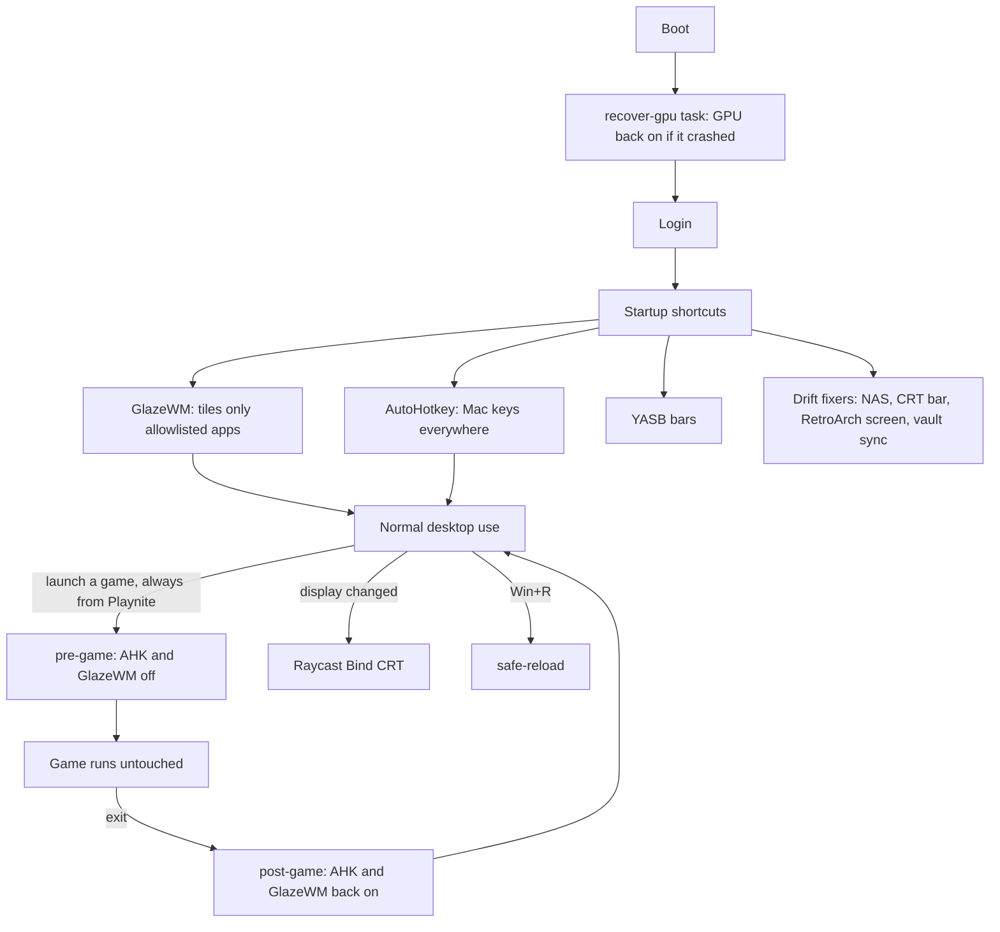

# How the Windows setup works

Windows does not want to be used like this. Five rules make it work. Everything in `scripts/` and
`.chezmoiscripts/` exists to keep one of them true.

## 1. GlazeWM is opt-in

It only manages apps named in its allowlist (`dot_glzr/glazewm/config.yaml`); a catch-all ignores
everything else. Games, installers and unknown windows are never tiled, so they never get frozen or
dragged. Cost: every new app you want tiled needs two lines, its workspace rule and the allowlist.

## 2. The registry takes keys back from Windows

`bootstrap/windows-tweaks.reg.tmpl`: Win+L is freed from lock so it can be bound, Win+E opens File
Pilot, Ctrl+Shift+Esc opens System Informer, PrtSc opens the snip overlay, toast popups are off so YASB
is the only notification surface. Open-Shell has no key. Run once on a fresh machine.

## 3. AutoHotkey gives Mac keys everywhere

`scripts/hotkeys.ahk`: Alt sits where Cmd is, so Alt+C/V/X/A/Z copy, paste, cut, select all and undo
in every app. WezTerm and RustDesk are excluded (WezTerm uses Alt itself; RustDesk should send the real
keys to the remote machine). Also the drop-downs (` terminal, Win+S Cider) and Win+D show desktop.

## 4. A few apps get tracked config only for keys

Where AHK cannot reach (an app's own shortcuts), chezmoi tracks that app's keybind file so it matches
the Mac: Zen (`bootstrap/zen-keyboard-shortcuts.json`), Zed (`AppData/Roaming/Zed/keymap.json`), File
Pilot (`AppData/Roaming/Voidstar/FilePilot/FPilot-Config.json`).

## 5. Every game launches through Playnite

Playnite's hooks run `scripts/playnite/pre-game.ps1` (stop AutoHotkey, kill GlazeWM) and
`post-game.ps1` (start both again). A game never sees a keyboard hook or a window manager, which also
keeps anti-cheat quiet. A game launched outside Playnite gets neither guard.

## Safety nets

Things that drift or break, and what puts them back:

| problem | fix | runs |
| --- | --- | --- |
| GPU hang leaves the GPU disabled and two monitors dark | `scripts/gpu/recover-gpu.ps1` | boot, as SYSTEM |
| N: is "Unavailable" because Windows mounts before Tailscale is up | `scripts/nas/mount-nas.ps1` | login, and Raycast "Reconnect NAS" |
| the CRT's display number changes, so its bar and RetroArch lose it | `fix-crt-bar.ps1`, `retroarch/bind-crt.ps1`, found by its 1024x768 resolution | login, and Raycast "Bind CRT" |
| a GlazeWM reload dumps every window on one workspace | `scripts/glazewm/safe-reload.ps1` | Win+R |
| keys stop working (another app grabbed them) | Raycast "AHK Off" / "AHK On"; check `%LOCALAPPDATA%\Raycast\Logs` and AMD's hotkeys | by hand |

Exact triggers for each script: `automation.md`. Every key: `keyboard-map.md`.
